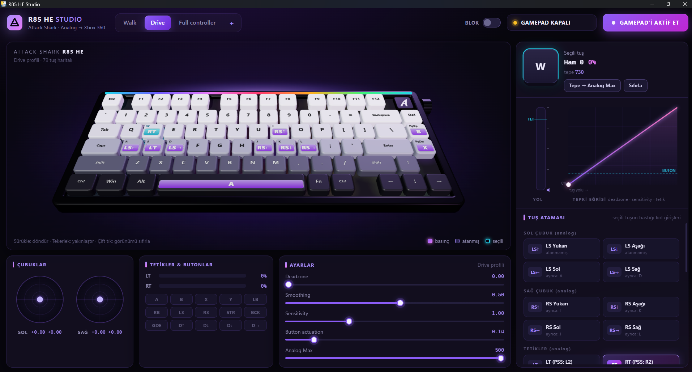

# R85 HE Studio

**Turn the Attack Shark R85 HE Hall Effect keyboard into a true analog Xbox 360 controller, with a 3D studio interface.**

[](#requirements)
[](LICENSE)



R85 HE Studio reads the real-time analog travel of every key on the **Attack Shark R85 HE** and feeds it into a virtual Xbox 360 controller through ViGEmBus. Press a key halfway and the stick moves halfway. It is built for games like **Forza Horizon 4** and **GTA V**, where analog steering and throttle make a real difference.

This project is a fork of [he-analog-gamepad](https://github.com/adapt-to-it/he-analog-gamepad) by Nerjak, which was made for the Attack Shark X68PRO HE. The original README is kept as [README_ORIGINAL.md](README_ORIGINAL.md).

## What's new in this fork

- **R85 HE support:** All **79 keys** were measured and mapped one by one (`key_config.json`).
- **3D studio interface:** A Wootility-style window with a 3D keyboard (three.js), rendered by pywebview (Edge WebView2).
- **Live analog view:** See each key's travel, raw value and pressure while you press it.
- **Per-key binding:** Assign any key to sticks, triggers or buttons from the interface.
- **Response curve:** Deadzone, sensitivity and trigger settings, plus "Peak → Analog Max" calibration.
- **Profiles:** Create, copy, rename and delete profiles. Settings are compatible with the original `gamepad_profiles.json`.
- **Single exe:** `build_r85_studio.bat` builds a standalone `R85Studio.exe`.

> The interface is in Turkish.

## Requirements

- Windows 10 or 11
- Attack Shark R85 HE connected **by USB cable** (analog data is not available over Bluetooth or 2.4 GHz)
- [ViGEmBus driver](https://github.com/nefarius/ViGEmBus/releases)
- Microsoft Edge WebView2 Runtime (already installed on most Windows 10/11 systems)

## Installation

### Option 1: Ready-made exe (easiest)

1. Install the [ViGEmBus driver](https://github.com/nefarius/ViGEmBus/releases) and restart your PC.
2. Download `R85Studio.exe` from the [Releases](../../releases) page.
3. Put it in the same folder as `key_config.json` from this repository.
4. Double-click `R85Studio.exe`.

### Option 2: Run from source

```bash
git clone https://github.com/mustii20/r85-he-studio.git
cd r85-he-studio
pip install -r requirements.txt
python r85_studio.py
```

To build your own exe, run `build_r85_studio.bat`.

## Key ID pattern

The R85 HE reports each key with an ID. The IDs follow a column-based pattern:

```
ID = column * 6 + row
```

- `Esc = 0`, and the function row follows as `F1..F12 = 6 * n`
- Bottom row exceptions: `Win = 11`, `Alt = 17`, `Fn = 65`, `Right Ctrl = 71`

If a key does not respond on your unit, use `key_mapper_gui.py` to remap it.

## Files

| File | Purpose |
|---|---|
| `r85_studio.py` | R85 Studio engine (pywebview window) |
| `ui/` | Interface: HTML, CSS, JS and three.js r128 |
| `gamepad_studio.py` | Core logic from the original project: HID reading, virtual controller, profiles |
| `key_config.json` | R85 HE key map (79 keys) |
| `key_mapper_gui.py` | Tool for mapping keys to analog IDs |
| `build_r85_studio.bat` | Builds `R85Studio.exe` with PyInstaller |
| `TECHNICAL.md` | HID protocol notes from the original project |

## Credits

- **Nerjak**: Original [he-analog-gamepad](https://github.com/adapt-to-it/he-analog-gamepad) project, HID protocol reverse engineering and the gamepad core. Huge thanks.
- [ViGEmBus](https://github.com/nefarius/ViGEmBus) and [vgamepad](https://github.com/yannbouteiller/vgamepad) for the virtual controller.
- [three.js](https://threejs.org/) for the 3D keyboard.

## License

MIT. See [LICENSE](LICENSE). The original copyright notice is preserved.
